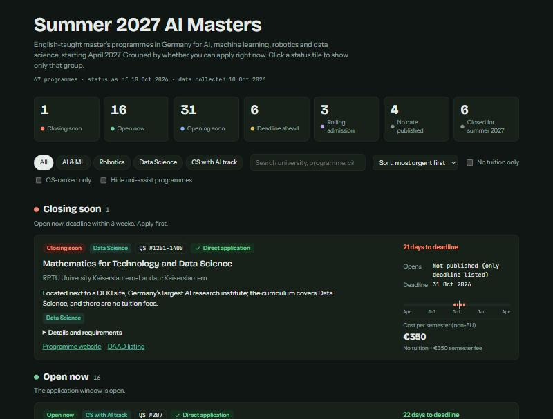

# Germany Masters Finder

[](https://github.com/M-Arib/germany-masters-finder/actions/workflows/ci.yml)
[](https://m-arib.github.io/germany-masters-finder/)
[](pyproject.toml)
[](LICENSE)

**Which English-taught AI, Machine Learning, Robotics and Data Science master's programmes in Germany can I apply to *right now*, what will they cost me, and do I need uni-assist?**

A free tracker built for **non-EU applicants**, currently covering the **Summer 2027** intake (studies start April 2027).

### 👉 [Open the dashboard](https://m-arib.github.io/germany-masters-finder/)

[](https://m-arib.github.io/germany-masters-finder/)

## What it shows

For each of 67 programmes (filtered from 143 on DAAD):

| | |
|---|---|
| **Admission status** | *Closing soon* · *Open now* · *Opening soon* · *Deadline ahead* · *Rolling* · *Closed*, worked out from today's date every time you open the page |
| **Opening date and deadline** | Including opening dates DAAD doesn't publish, researched on university websites, each with a source link |
| **Cost per semester** | Non-EU tuition + semester fee in one number (several Bavarian and Baden-Württemberg universities now charge non-EU students) |
| **uni-assist** | 🔴 red warning where uni-assist or a VPD is required, since it adds 4–8 weeks and a fee |
| **QS World Ranking 2026** | Or "Not QS-ranked" (most universities of applied sciences) |
| **Skills taught** | Machine Learning, Deep Learning, Computer Vision, NLP, Robotics… from the course description |
| **Why choose it** | One line on what sets the programme or university apart |

Filter by field (AI & ML · Robotics · Data Science · CS with AI track), search by skill or city, hide uni-assist programmes, show only tuition-free ones, or sort by cost or ranking.

## Why another site?

[DAAD's International Programmes database](https://www2.daad.de/deutschland/studienangebote/international-programmes/en/) is the authoritative source, and this project is built on it. But DAAD doesn't tell you whether you can apply today, often omits when applications open, and spreads fees and uni-assist rules across long text fields. Aggregator sites cover more countries but are frequently out of date. This tracker answers the questions applicants actually ask, for one well-defined group of programmes, and links every fact back to its source.

## How it works

```
DAAD search API ──► detail page per programme ──► data/summer_2027.csv ──► docs/index.html
                         (daad.py)                    (scrape.py)           (dashboard.py)
                                      + researched opening dates, QS ranks (reference.py)
                                      + fee, date, skill and uni-assist parsing (classify.py)
```

- Data is refreshed with `scripts/refresh.ps1`, which scrapes, tests, commits and pushes. DAAD blocks requests from cloud servers, so this runs from a normal internet connection rather than GitHub Actions.
- Admission status is computed **in the browser** from today's date, so it stays correct between refreshes.
- The dashboard is a single static HTML file with no backend, tracking or cookies.

## Run it yourself

```bash
git clone https://github.com/M-Arib/germany-masters-finder.git
cd germany-masters-finder
pip install -e ".[dev]"

python -m germany_masters all      # scrape DAAD (~2 min) and build docs/index.html
python -m germany_masters build    # rebuild the dashboard from data/ only
pytest                             # run the tests
```

To refresh and publish the live dashboard (Windows PowerShell): `.\scripts\refresh.ps1`

**Different subjects or intake?** Set up a search on the [DAAD website](https://www2.daad.de/deutschland/studienangebote/international-programmes/en/), paste the result URL into `TARGET_URL` in [`config.py`](src/germany_masters/config.py), and adjust the intake settings next to it.

## Project layout

```
src/germany_masters/
  config.py      search URL, intake cycle, file paths
  daad.py        DAAD search API + detail-page parser
  reference.py   hand-researched data: opening dates, QS ranks, fee and uni-assist overrides
  classify.py    dates, fees, skills, focus, uni-assist status, "why" notes
  scrape.py      scrape → data/summer_2027.csv
  dashboard.py   CSV → docs/index.html
templates/dashboard.html   page design and in-browser logic
data/                      generated programme data (CSV)
docs/                      generated dashboard, served by GitHub Pages
tests/                     unit tests and a trimmed DAAD page fixture
scripts/refresh.ps1        scrape → test → commit → push
```

## ⚠️ Accuracy

Deadlines, fees and requirements change every year, and some values are estimates (marked "≈", "approx." or "expected"). **Always confirm on the official programme page before applying.**

- Deadlines are for **non-EU applicants** where universities list them separately.
- 🟢 "Direct application" only means DAAD doesn't mention uni-assist. Check the programme website.
- Skills come from the DAAD course description; programmes may teach more than their tags show.

Found something wrong? [Report it](https://github.com/M-Arib/germany-masters-finder/issues/new?template=data-correction.yml) with a link to the official page.

## Contributing

Corrections and improvements are welcome. See [CONTRIBUTING.md](CONTRIBUTING.md). Changes are listed in [CHANGELOG.md](CHANGELOG.md).

## Data sources and license

- Programme data: [DAAD International Programmes](https://www2.daad.de/deutschland/studienangebote/international-programmes/en/) © DAAD
- Application opening dates: university websites (linked per programme)
- Rankings: [QS World University Rankings 2026](https://www.topuniversities.com/world-university-rankings), via [learngermanonline.org](https://www.learngermanonline.org/top-german-universities/)

Code is released under the [MIT License](LICENSE). Programme data belongs to DAAD and the respective universities. This project is not affiliated with DAAD, uni-assist or any university.
